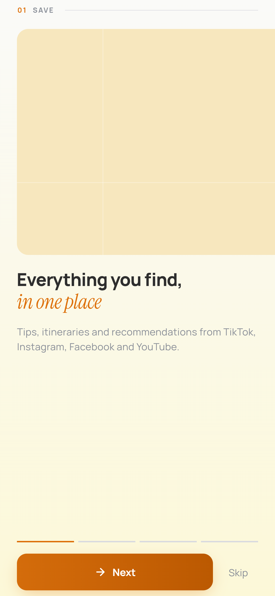
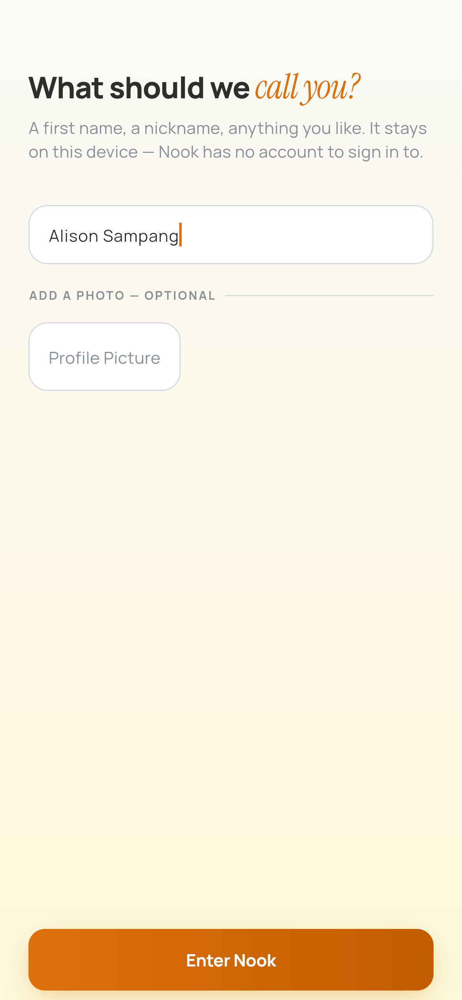
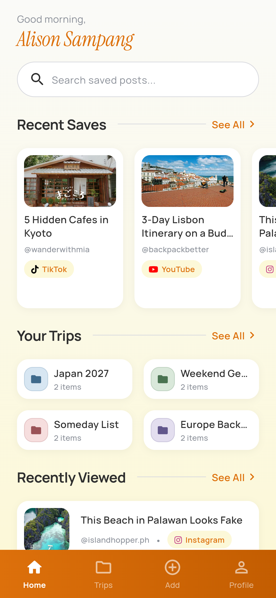
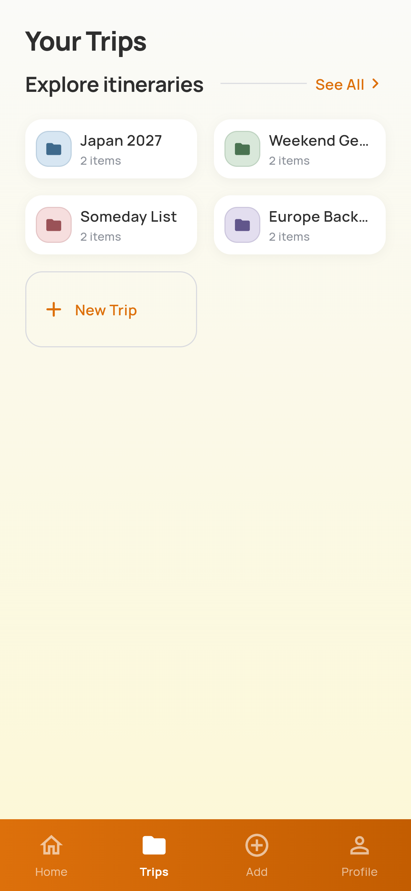
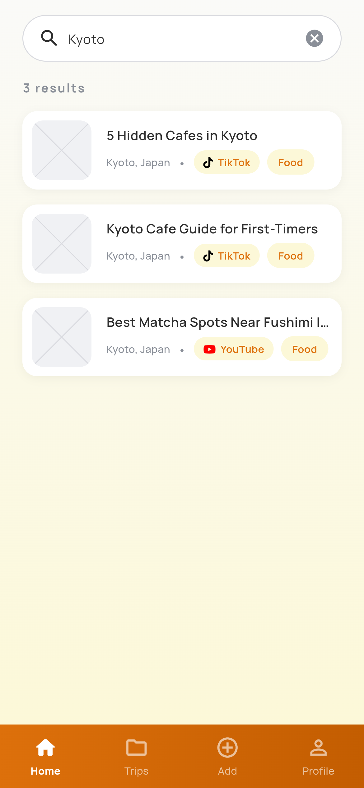
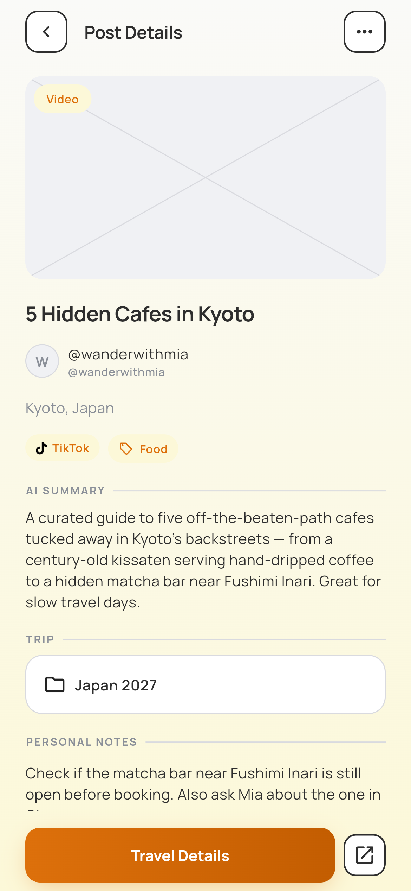
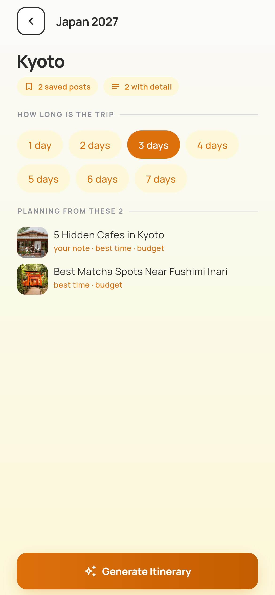
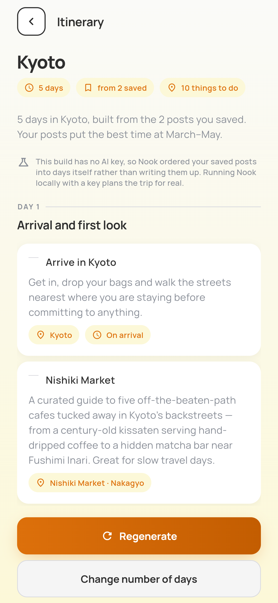
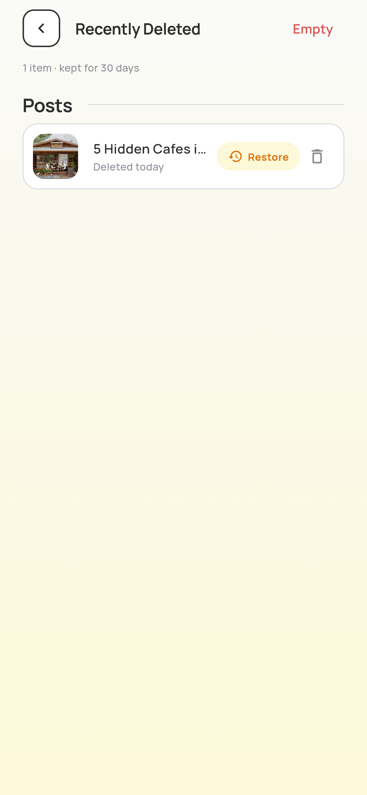

# Nook

> Never lose your next favourite find. Nook saves the travel content you find on
> TikTok, Instagram, Facebook and YouTube in one place — grouped by trip,
> searchable across every platform, and able to turn what you saved into a
> day-by-day itinerary — for travellers whose trip research is currently
> scattered across four apps.

**Live demo:** https://alyencs.github.io/nook-flutter/
**Demo video:** https://github.com/alyencs/nook-flutter/tree/main/docs/demo
**Course:** Applications Development and Emerging Technologies (6ADET), Holy Angel University
**Author:** Alison C. Sampang

This repository lives in the author's own GitHub account and is public on
purpose. There is no `student.json` here and there should not be one: see
[`docs/06-security-and-privacy.md`](docs/06-security-and-privacy.md) for what a
public repo means for secrets and personal data, and
[`SECURITY-CHECKLIST.md`](SECURITY-CHECKLIST.md) for the audit behind it.

---

## Screenshots

| Onboarding | Set up profile | Home |
| --- | --- | --- |
|  |  |  |

| Trips | Search results | Post details |
| --- | --- | --- |
|  |  |  |

| Choose a duration | Generated itinerary | Recently Deleted |
| --- | --- | --- |
|  |  |  |

*Captured from the current build at 390×844 on a 3× screen, with
`--dart-define=NOOK_DEVICE_PREVIEW=false` so the preview frame is off. The
itinerary shown is the keyless one: the machine they were taken on has no API
key, so Nook's own planner arranged the saved posts and the screen says so.
Travel Details is not included because its map tiles could not be reached from
that machine. The live link renders both.*

## What it does

- **Paste a link to save it** — TikTok, Instagram, Facebook or YouTube. The
  platform is recognised from the URL. Nook is also a Web Share Target, so once
  it is installed to a home screen you can share straight into it and analysis
  has already started by the time the app opens.
- **Detection reads the post, not just the link.** Nook fetches what the platform
  publishes — a YouTube title and description, a TikTok caption — and hands that
  to the model, which returns the place, a category, a summary, the country, the
  best time to visit, a rough budget, the venues the post named and its tips.
  Anything it cannot tell you is left blank rather than invented.
- **Write a note instead.** Not everything worth keeping is a link, so a post can
  be typed rather than pasted and lives alongside the saved ones.
- **Group saves into trips** with coloured folders, and see where a save is on a
  map you can drag, pinch and zoom.
- **Explore Itinerary turns a trip into a plan.** Pick a trip, choose how many
  days, and Nook builds a day-by-day itinerary out of the posts already saved
  into it — the venues they named, the tips in them and your own notes. See
  [below](#explore-itinerary).
- **Search across everything** — titles, creators, destinations, countries,
  categories and your own notes, in one field.
- **Delete without losing anything.** Deleted posts and trips wait in Recently
  Deleted for 30 days and can be restored.
- **Onboarding that explains the app, not a sign-up.** A splash, four
  illustrated pages and one question — what to call you. There is no account,
  no password and no email, because there is no server.
- **Export everything** as one JSON file: the profile, the trips, every saved
  post with its full extraction and notes, the search history and the settings.

## How it works

Nook is a Flutter web app with **no backend for user data**. Everything a person
saves lives in a [Drift](https://drift.simonbinder.eu) (SQLite) database on their
own device — no account, no sync, no server-side copy. The only thing that ever
leaves the device is a link they asked Nook to analyse.

There is one small server-side piece, and it holds exactly one thing: the
Anthropic API key. It stores no user data. A web build is public in full, so a
billable key cannot live inside one; the key sits on that service instead and
the browser asks the service. See
[How the deployed app reaches the model](#how-the-deployed-app-reaches-the-model).

```
a link ──▶ platform lookup (oEmbed / Graph API)
                 │
                 ▼
         Nook's AI service ──▶ Claude Haiku 4.5 ──▶ structured JSON
         (holds the key)                                   │
                                                           ▼
                                        editable review ──▶ Drift (on device)
                                                              │
   saved posts in a trip ──▶ Nook's AI service ──▶ Claude Haiku 4.5
                                                       │
                                                       ▼
                                           a day-by-day itinerary
```

- `lib/ai/` — the model client, the two AI features, and a keyless fallback for
  each. It knows nothing about Drift or Flutter widgets.
- `lib/data/` — the Drift database, its tables, the DAOs and the demo seed.
- `lib/screens/` — one folder per area: onboarding, home, search, add, details,
  trips, explore, profile.
- `lib/widgets/`, `lib/theme/` — the design system: one place each for colour,
  type, spacing, motion and the shared components.
- `AppScope`, an `InheritedWidget`, hands the database, the DAOs and the chosen
  AI services down the tree. There is no state-management package: screens read
  Drift's stream queries through `StreamBuilder`, so saving a post updates Home,
  Trips and Search on its own.

## AI functionality

**Provider:** Anthropic. **Model:** Claude Haiku 4.5
(`claude-haiku-4-5-20251001`), pinned by id so a new release cannot change how
an installed build behaves. `CLAUDE_MODEL` overrides it.

Nook speaks the Messages API over plain HTTP (`lib/ai/claude_api.dart`), with
retry and backoff that honour the server's own `retry-after`. Both features ask
for structured output through a forced tool call, so the reply arrives as a
decoded object of a known shape rather than prose that has to be parsed.

**Where that request goes depends on how the build is configured**, and the
request body is identical either way:

| Configuration | The request goes to | Carries a key? |
| --- | --- | --- |
| `AI_BACKEND_URL` set (how the deployed site runs) | Nook's AI service, which attaches the key and forwards it | No |
| A key passed as `--dart-define` (local work only) | `api.anthropic.com` directly | Yes — so such a build must not be published |
| Neither | Nowhere; the sample extractor and sample planner run | No |

Two features use it:

1. **Extraction** (`lib/ai/claude_extractor.dart`) — reads one saved link into a
   destination, a category, a summary, coordinates, the venues it named and its
   tips. Every field is optional, and a field the source does not support comes
   back null rather than guessed.
2. **Explore Itinerary** (`lib/ai/claude_itinerary_generator.dart`) — builds a
   plan from several saved posts at once.

**With nothing configured, both still work.** `SampleExtractor` and
`SampleItineraryGenerator` do the same jobs deterministically and without a
network, and the UI says on screen which one produced what you are looking at.
That fallback is why the app has always been publishable: a billable key must
never be compiled into a public web build, so before the service existed the
deployed site ran the samples. With `NOOK_AI_BACKEND` pointed at a deployed
service, the published site now runs the real model and still carries no key.

### Explore Itinerary

From the Trips tab, **Explore itineraries → a trip → a number of days →
Generate**.

- **The saved posts are the context.** Each post's title, caption, summary,
  place names, area, city, country, best time, budget note, tips and your own
  personal note are sent as the material to plan from. Nothing is invented from
  the destination's reputation and nothing is summarised on the way in.
- **You choose the length** — 1 to 7 days. The generator is held to the number
  you picked: more days than asked for are trimmed, and fewer is reported rather
  than padded out with a day nobody planned.
- **A trip with nothing in it is refused before a call is made**, as is a trip
  whose posts are only titles, with a message saying what to add.
- **The result** is a day-by-day plan — a title per day, two to five activities,
  each with a description and, where the posts support it, a place and a time —
  plus a one-line overview. Regenerate and change-the-duration are on the same
  screen.
- Two taps on Generate make one request, not two.

## Built with

| | |
| --- | --- |
| Framework | Flutter (Dart), web target |
| State | `setState` plus Drift stream queries read through `StreamBuilder` — no state-management package, because every screen reads one query and a package would be ceremony |
| Storage | [Drift](https://drift.simonbinder.eu) — on-device SQL, five tables at schema version 7, works on web. Chosen over Hive because a post belonging to exactly one trip is a foreign key, not a key-value pair |
| AI | Anthropic Messages API, Claude Haiku 4.5, spoken over `http` with structured output via tool use |
| AI service | `server/` — a single `fetch` handler (plain JavaScript, no framework) for Cloudflare Workers, holding the API key so the web build never does. Tested with `node --test`; no key needed to run its suite |
| Other packages | `http` (the Messages API and the oEmbed lookups — plain HTTP, so the status code survives and a retryable 529 can be told from a fatal 400), `flutter_map` + `latlong2` (OpenStreetMap tiles, no key and no billing account), `flutter_dotenv` (keys out of git), `image_picker` (profile photo), `url_launcher`, `font_awesome_flutter` (platform brand marks), `device_preview` (the phone frame and the preview panel on the live link) |

Storage is on the device and nowhere else, deliberately: two travellers never
need to see the same saved posts, so a server would be work for nothing. The
trade-off accepted is that saves do not sync between devices. The five tables are
`users`, `trips`, `saved_posts`, `recent_searches` and `app_settings`; the
reasoning is in [`docs/01-proposal.md`](docs/01-proposal.md).

## Running it yourself

```bash
flutter pub get
cp .env.example nook.env  # required, even left empty — see below
flutter run -d web-server --web-port 8080
```

Then open http://localhost:8080. Built and tested with **Flutter 3.47.6 /
Dart 3.13.5**; `pubspec.yaml` requires Dart `^3.8.0`. This is a web-only project
— there is no `android/` or `ios/` directory.

`nook.env` is listed as an asset in `pubspec.yaml` (that is how `flutter_dotenv`
reads it), so **the file has to exist before the app will build**, even empty.
Every value in it is optional; Nook runs with none of them set, and first launch
seeds a small fictional demo library so the app opens looking like the design.

```bash
flutter analyze    # clean
flutter test       # 386 tests, 383 passing — see known issues below
flutter build web --release
dart run build_runner build --delete-conflicting-outputs   # after editing lib/data/tables.dart
```

To build without the preview — which is how the screenshots above were taken:

```bash
flutter build web --release --dart-define=NOOK_DEVICE_PREVIEW=false
```

### How the deployed app reaches the model

GitHub Pages serves static files, so everything the app ships is readable by
anyone who opens it. A billable key cannot live there, and a GitHub Actions
secret does not help: a secret used at build time ends up in the build, and
the build is what is served.

So the key lives in a small service of its own, in `server/`:

```
browser (github.io)  ──POST /v1/messages──▶  Nook's AI service  ──key──▶  api.anthropic.com
     carries no key                           holds the key
```

The only AI-related thing the published bundle carries is that service's
address, which is public by necessity. `server/README.md` has the deployment
steps; they take about five minutes and need no payment details.

**The address must end in `/v1`** — for example
`https://nook-ai.your-subdomain.workers.dev/v1`. The app configures a *base*
and appends the method to it, exactly as it would with Anthropic's own base of
`https://api.anthropic.com/v1`, and the service answers on `/v1/messages` so
that the two are interchangeable. Leave the `/v1` off and every request lands
on `/messages`, which returns 404 — and because the screens report a failure in
plain words rather than a status code, it looks like the model is down rather
than like a mis-typed URL. `server/README.md` has a table of the other failure
modes.

Without the service configured, the app runs its sample extractor and sample
planner and says so on screen — which is what every build did before, and is
still a perfectly good demo.

### Checking a deployment

Two things are served next to the app and are worth knowing about when the
live link does not behave:

* `build.txt` — the commit, branch and time of the build that is actually
  live. A run that fails to deploy leaves the previous build up, and from the
  browser the two are indistinguishable.
* `diagnose.html` — a standalone page that reports which bundle this browser
  has, any service worker still registered, the window size, zoom, WebGL and
  storage, and whether the browser is delivering clicks to the page at all. It
  loads none of the app, so it still answers when the app does not.

### Configuration

Configuration comes from two places, and which one a value goes in is decided
by a single question: **is it safe to publish?**

A web build is public in full. Every string in `main.dart.js` and every bundled
asset is downloadable by anyone who opens the page, so there is no such thing
as a private value inside one. That rules out the usual hiding places — a
repository secret used at build time ends up in the build, and the build is
what is served.

#### Settings, in `nook.env`

Public values. `pubspec.yaml` lists this file as an asset, which is how
`flutter_dotenv` reads it and also means **the file is served to visitors
verbatim**. Copy `.env.example` over it; it must exist before the app will
build, even empty.

| Variable | What it is | Where to get one |
| --- | --- | --- |
| `AI_BACKEND_URL` | Nook's AI service, which holds the Anthropic key so the app never has to. This is how a published build reaches the real model. A public address by necessity — the browser has to know where to knock. **Must end in `/v1`** (see below). Blank, and Nook runs its sample extractor and sample planner and says so on screen. | `server/README.md` |
| `CLAUDE_MODEL` | Optional model id to pin. Blank lets the service choose, which is the point of letting it choose: the model can change without rebuilding the app. | — |

That is the whole list, and no credential is on it. The app reads nothing else
from this file — not as a convention, but because no code path exists that
would. `test/no_bundled_credential_test.dart` fills the file with keys and
asserts every one of them is ignored.

#### Credentials, as `--dart-define`

Billable values, for running against the real model **from your own machine**
with no service in between. A `--dart-define` is a property of one command on
one machine rather than a file that travels with the project:

```bash
flutter run -d chrome \
  --dart-define=ANTHROPIC_API_KEY=sk-ant-...
```

| Define | What it buys | Where to get one |
| --- | --- | --- |
| `ANTHROPIC_API_KEY` | Destination, category, summary and coordinate detection, and the Explore Itinerary plans, called straight from the browser. **Billable.** Ignored entirely when `AI_BACKEND_URL` is set — a build that can reach the service has no business also carrying a key. | https://console.anthropic.com/settings/keys |
| `YOUTUBE_API_KEY` | A video's description, where the addresses and prices are, plus the creator's profile picture. Free tier, no billing account. Without it extraction works from the title alone. | [Enable YouTube Data API v3](https://console.cloud.google.com/apis/library/youtube.googleapis.com) |
| `FACEBOOK_TOKEN` | `APP_ID\|CLIENT_TOKEN` from a Meta app with **oEmbed Read**. The only way to read an Instagram or Facebook caption — both withdrew public oEmbed in 2020. Without it those two extract from the URL alone, and the prompt says so. | [developers.facebook.com/apps](https://developers.facebook.com/apps) → Settings → Advanced |

**A build made with any of these must not be published.** A `--dart-define` is
compiled into `main.dart.js` like anything else; what it avoids is a key
sitting in a file that gets copied, committed or built by accident. The
deployed build passes none, which is what makes it safe to serve.

Not a rule to remember, either — `tool/check_bundle.sh` reads the finished
build and refuses a credential it finds in any file, and the deploy workflow
runs it as the last step before publishing:

```bash
flutter build web --release
./tool/check_bundle.sh build/web
```

### Backend and API requirements

There is **no database to provision**, no account system and no migrations to
apply anywhere but the device. Saves, trips and settings never leave the phone.

One small service does exist, in [`server/`](server/README.md), and its only
job is to hold the Anthropic key. It is a single `fetch` handler of a few
hundred lines, deployable to Cloudflare Workers' free tier in about five
minutes with no payment details. It is optional: without it the app runs its
sample extractor and sample planner.

| Service | Used for | Needs a key |
| --- | --- | --- |
| Nook's AI service (`server/`) | Extraction and itinerary generation, with the key held server-side | Yes, on the server — `wrangler secret put` |
| `api.anthropic.com` | The same, called directly, for local work only | `ANTHROPIC_API_KEY` as a `--dart-define` |
| YouTube and TikTok oEmbed | A post's real title, creator and thumbnail | No |
| YouTube Data API, Meta Graph API | A video's description; Instagram and Facebook captions | `YOUTUBE_API_KEY`, `FACEBOOK_TOKEN` |
| `tile.openstreetmap.org` | Map tiles on Travel Details | No |

The two AI rows are the same feature reached two ways, and only one of them is
publishable. Set `AI_BACKEND_URL` and the app sends its request to the service,
which attaches the key and forwards it; the bundle carries the address and
nothing else. Leave it blank and pass a key instead and the browser calls
Anthropic itself, which is convenient locally and must not be deployed. The
reasoning, and what the service will and will not do with the key, is in
[`server/README.md`](server/README.md) and
[`docs/06-security-and-privacy.md`](docs/06-security-and-privacy.md).

## Privacy and secrets

- **What is stored.** A local profile (a name and an optional photo), saved posts,
  trips, recent searches and four settings toggles — all in a Drift database on
  the device. Nothing is uploaded, shared or synced. There is no account, so
  there are no user records anywhere to protect: no Firestore rules, no Supabase
  RLS, no password. The only thing that ever leaves the device is a link you
  asked Nook to analyse, plus what the platform has already published about it.
  Nook's AI service sees that link on its way to the model and stores none of
  it — it has no database and keeps no log of request content.
- **Where the secrets live.** The Anthropic key lives on Nook's AI service, in
  the hosting platform's encrypted environment, where it cannot be read back —
  only replaced. Nothing credential-shaped goes in `nook.env`, because that file
  is a bundled asset and so is served to every visitor; it holds the service's
  address and an optional model id, both public. A key for local work is passed
  as a `--dart-define` to one command instead, and `tool/check_bundle.sh` fails
  the deploy if a credential is found in a build about to be published.
  `nook.env` carries no leading dot because the Pages upload strips dotfiles
  from the artifact, which left the asset missing from the live site.
- **No real personal information** appears in the sample data, the screenshots or
  the video. Every trip, post, handle and link in the seeded library is invented.

The full audit, including the open items, is
[`SECURITY-CHECKLIST.md`](SECURITY-CHECKLIST.md).

## Project documentation

| Document | |
| --- | --- |
| [Proposal](docs/01-proposal.md) | the problem, the users, the scope |
| [Mockup and wireframes](docs/02-mockup.md) | what it looks like, and the screen flow |
| [Design system](docs/03-design-system.md) | colours, type, spacing, components |
| [Weekly reports](docs/04-weekly-reports.md) | what happened each week |
| [Demo video](docs/05-demo-video.md) | the recording and what it shows |
| [Security and privacy](docs/06-security-and-privacy.md) | the checklist, filled in |
| [Security checklist](SECURITY-CHECKLIST.md) | the audit, item by item |
| [AI use](AI-USAGE.md) | the full account of how AI was used |
| [AI service](server/README.md) | what the service does, its limits, and how to deploy it |

## Status and what is next

**Working:** every screen in the mockup, plus the Trips tab and Trip Details the
mockup never drew. Save by link, by share or as a note; detection with an
editable result; trips with folder colours; Explore Itinerary with a chosen
duration; search; personal notes; an interactive map; Recently Deleted with
restore and a 30-day window; a local profile with an adjustable photo crop; and a
complete JSON export.

**Deliberately not built:** Connected Platforms — auto-sync from a connected
account — is drawn as designed with every control disabled and labelled. Sharing
a post *out* of Nook is drawn but inert.

**Known issues, honestly:**

- **Three tests fail on the seeded library.** Two in `dao_test.dart` and one in
  `widget_test.dart`, asserting post counts and a thumbnail shape that the
  current demo seed no longer matches. They are assertions about the fixture,
  not about the app, and they are the next thing to fix.
- **The 40-link extraction test is still outstanding.** Ten real links per
  platform, logging how often a usable destination comes back. It is the
  mitigation the proposal committed to for its biggest risk, and it needs a
  normal network and a key.
- **Creator profile pictures are YouTube-only.** Of the four platforms, only
  YouTube exposes an avatar through a route Nook can legitimately use, and only
  with a `YOUTUBE_API_KEY`. Everywhere else the UI draws the creator's initial
  rather than inventing a face.
- **Instagram and Facebook need a token for anything beyond the URL.** Without
  `FACEBOOK_TOKEN` those saves keep the drawn placeholder and extract from the
  link alone.
- **Extraction quality still depends on what the platform publishes.** An opaque
  URL may come back without a destination, which is why every field is optional
  and editable.

## Credits

- Packages: see `pubspec.yaml`
- Nook logo: the author's own. The splash mark in `assets/images/` is cut from
  the supplied `nook_logo.png` along its own gutters — the four crops reassemble
  into that file exactly.
- Typefaces: [Manrope](https://github.com/sharanda/manrope) by Mikhail Sharanda,
  and [Instrument Serif](https://github.com/Instrument/instrument-serif) standing
  in for PP Editorial New, which is licensed from Pangram Pangram and cannot be
  committed — both SIL Open Font License 1.1
- Icons: Material Icons, Apache License 2.0
- Platform logos: [Font Awesome Free](https://fontawesome.com) brand icons, CC BY 4.0
- Map tiles: © OpenStreetMap contributors, ODbL
- Seeded destination photographs: Wikimedia Commons, under their own licences
- Onboarding photographs: `assets/images/onboarding_1.jpg` … `onboarding_4.jpg`,
  under their own licences

## AI use


**Claude (Anthropic), used heavily, and directed throughout.** It wrote the first
full build and much of what followed, working to my specification and under my
review — I specified it, rejected parts of it, and merged all of it.

**A little under a third of this application is mine: 27% of `lib/` and 37% of
`test/` by line, across 45 of the repository's 65 commits.** That includes Explore
Itinerary end to end — eight files and 1,906 lines with no AI co-authorship on any
of the commits — the Anthropic Messages API client in `lib/ai/claude_api.dart`,
which I wrote by hand over plain `http` so a retryable overload stays
distinguishable from a fatal bad request, and 1,977 lines of tests covering that
client, both itinerary generators and the three Explore screens. Nook's motion
system is mine as well, along with the planning documents the whole app is shaped
by.

I reviewed what Claude produced and rejected a fair amount of it, including a
splash screen that assembled a logo it had invented twice.

The full account — eight examples of how I used it, three cases where it was
wrong, and the line-by-line authorship breakdown with the commands to reproduce
it — is in [AI-USAGE.md](AI-USAGE.md).

## Licence

MIT, see [LICENSE](LICENSE).
